# Phase 4 model confirmations

Spec 4.12, written at integration from the merged code of Parts 1 to 4 and their tests
(integration decision 223). Every "Holds" names the test that shows it, as
`file::test` under `tests/`. All the tests named here passed in the integration run of
`pytest --run-integration --ignore=tests/acceptance` on a fresh PostgreSQL 16 database. Nothing
here is claimed from reading the code alone; section 4 lists what no test shows.

Part 4's earlier version of this file (built on `phase4-part4-platform` before Parts 1 to 3
existed) is replaced. Its known entries (INV-1's 409 half, INV-7's nightly run, INV-8, INV-10,
INV-11, INV-13) are kept below with their tests.

## 1. Model 1 as built (Common section 5)

### States

| Model 1 | Stored as | Shown by |
| --- | --- | --- |
| FLAGGED | `state = FLAGGED` | `part1/test_review_prefill.py::test_ac07_prefill_fills_the_rights_field_and_leaves_the_others_blank` (a new breach event is FLAGGED with no disposition) |
| UNDER_REVIEW | `state = UNDER_REVIEW` | `part1/test_review_start.py::test_a_reviewer_view_moves_flagged_to_under_review` |
| CLASSIFIED(tier) | `state = DISPOSITIONED`, serious tier, `deadline_utc` set | `part2/test_disposition_api.py::test_a_first_disposition_records_contract_example_2` |
| CLOSED_NOT_SERIOUS | `state = CLOSED`, NOT_SERIOUS, rationale stored, `deadline_utc` null | `part2/test_disposition_api.py::test_ac09_not_serious_with_a_rationale_closes_with_no_deadline` |
| DENIED | no state: 401 or 403, nothing written | `part2/test_disposition_api.py::test_ac14_non_reviewers_are_denied_on_both_actions` |
| REJECTED (no disposition) | no state: 409 NO_DISPOSITION on the report | `part2/test_disposition_api.py::test_ac08_a_report_without_a_disposition_is_409_and_changes_nothing` |
| REJECTED (invalid disposition) | no state: 400 RATIONALE_REQUIRED or 409 HARM_FIELDS_UNCONFIRMED, nothing written | `part2/test_disposition_api.py::test_ac09_not_serious_without_a_rationale_is_contract_example_3`; `part1/test_review_integration.py::test_rejected_harm_fields_write_nothing_and_append_nothing`; `part2/test_disposition_gaps.py::test_a_revision_with_unconfirmed_harm_fields_writes_nothing` |
| ESCALATION | no state: `escalation` rows and reminder notifications | `part3/test_escalations.py::test_ac12_fires_at_50_80_100_and_not_at_49_79_99`; `part3/test_reminder_delivery.py::test_the_reminder_body_is_the_pinned_shape` |
| REPORT_READY, SUBMITTED | not built (Phase 5) | `part2/test_disposition_api.py::test_a_report_after_any_disposition_is_501_until_phase_5` |
| GAP_OPEN, REVIEWER_NOTIFIED, GAP_CLOSED | `type = monitoring_gap`, FLAGGED then CLOSED | `part1/test_review_start.py::test_a_gap_event_never_enters_under_review` (both gap states) |

### Transitions and the test that proves each guard

| From | Trigger and guard | To | Ledger | Test |
| --- | --- | --- | --- | --- |
| FLAGGED (breach) | Reviewer views the detail (D3) | UNDER_REVIEW | EVENT_VIEWED, REVIEW_STARTED | `part1/test_review_start.py::test_a_reviewer_view_moves_flagged_to_under_review`, `::test_the_audit_trail_shows_the_review_start`; the guard: `::test_a_viewer_view_changes_nothing`, `::test_a_system_key_gets_403_and_writes_nothing`, `::test_a_second_reviewer_view_appends_event_viewed_only`, `::test_a_breach_event_past_flagged_is_not_moved`, `::test_twenty_parallel_reviewer_views_start_the_review_once` |
| FLAGGED | Serious tier, four fields decided | DISPOSITIONED | DISPOSITION_RECORDED | `part2/test_disposition_api.py::test_a_first_disposition_records_contract_example_2`, `::test_ac09_each_of_the_four_tiers_is_accepted` |
| UNDER_REVIEW | Serious tier, four fields decided | DISPOSITIONED | DISPOSITION_RECORDED | `part2/test_disposition_api.py::test_a_reviewers_view_then_a_disposition_moves_under_review_to_dispositioned` |
| FLAGGED or UNDER_REVIEW | Guard: all four fields CONFIRMED or NOT_APPLICABLE | unchanged on failure (409) | none | `part1/test_review_integration.py::test_rejected_harm_fields_write_nothing_and_append_nothing`; `part1/test_review_decisions.py::test_require_complete_turns_each_incomplete_input_into_409` |
| FLAGGED or UNDER_REVIEW | NOT_SERIOUS with a non-blank rationale | CLOSED | DISPOSITION_RECORDED | `part2/test_disposition_api.py::test_ac09_not_serious_with_a_rationale_closes_with_no_deadline`; the guard (null, empty, spaces, whitespace, ideographic space, absent: 400): `::test_ac09_not_serious_without_a_rationale_is_contract_example_3` |
| DISPOSITIONED | Stricter or same serious tier | DISPOSITIONED | DISPOSITION_REVISED | `part2/test_disposition_api.py::test_ac11_revisions[stricter]`, `[death to critical]`, `[same tier]`; `part2/test_disposition_gaps.py::test_same_tier_and_looser_revisions_stay_dispositioned[same tier]` |
| DISPOSITIONED | Looser serious tier with a non-blank rationale; without one 409 and nothing written | DISPOSITIONED | DISPOSITION_REVISED | `part2/test_disposition_api.py::test_ac11_revisions[looser with rationale]`, `[looser without rationale]`, `[critical to death without rationale]`; `part2/test_disposition_gaps.py::test_same_tier_and_looser_revisions_stay_dispositioned[looser with a rationale]`, `::test_a_blank_rationale_never_extends_a_deadline` |
| DISPOSITIONED | **D2 edge.** NOT_SERIOUS with a rationale (400 without): deadline cleared, unsent reminders cancelled | CLOSED | DISPOSITION_REVISED | `part2/test_disposition_api.py::test_d2_revisions_into_and_out_of_not_serious`; reminders: `part2/test_disposition_integration.py::test_d2_revisions_cancel_and_replan_the_reminders`, `part3/test_escalations.py::test_not_serious_cancels_only_unsent_rows_and_a_reopen_does_not_resend` |
| CLOSED (NOT_SERIOUS) | **D2 edge.** Serious tier: deadline from the first anchor, even if past; a looser tier than the last serious one needs a rationale (Addendum rule 1) | DISPOSITIONED | DISPOSITION_REVISED | `part2/test_disposition_api.py::test_d2_revisions_into_and_out_of_not_serious`, `::test_addendum_rule_1` (six cases); `part2/test_disposition_gaps.py::test_a_blank_rationale_never_extends_a_deadline[reopen to OTHER_SERIOUS-*]`; reminders: `part2/test_disposition_integration.py::test_addendum_rule_1_reopens_and_the_reminders`, `part3/test_escalations_integration.py::test_not_serious_then_reopen_through_the_api` |
| CLOSED (NOT_SERIOUS) | NOT_SERIOUS again with a rationale | CLOSED | DISPOSITION_REVISED | `part2/test_disposition_api.py::test_d2_revisions_into_and_out_of_not_serious` (the NOT_SERIOUS to NOT_SERIOUS step) |
| monitoring_gap, any state | Disposition call | unchanged | none (409 EVENT_NOT_REVIEWABLE) | `part2/test_disposition_api.py::test_a_gap_event_cannot_be_dispositioned_and_has_no_report` |
| any | Disposition or report by a non-reviewer | unchanged | none (401 or 403) | `part2/test_disposition_api.py::test_ac14_non_reviewers_are_denied_on_both_actions` (viewer, system key, no key; before and after a disposition) |

### Model 1 diagram as built

The two D2 edges (decision D2, "follow the contract") are the ones Model 1's original diagram did
not have: CLOSED_NOT_SERIOUS is not final, and revisions are not limited to the CLASSIFIED loop.

```mermaid
stateDiagram-v2
    [*] --> FLAGGED: breach sample (Phase 3)
    FLAGGED --> UNDER_REVIEW: reviewer views detail (D3)
    FLAGGED --> CLASSIFIED: serious tier, four fields decided
    UNDER_REVIEW --> CLASSIFIED: serious tier, four fields decided
    FLAGGED --> CLOSED_NOT_SERIOUS: NOT_SERIOUS + rationale, four fields decided
    UNDER_REVIEW --> CLOSED_NOT_SERIOUS: NOT_SERIOUS + rationale, four fields decided
    CLASSIFIED --> CLASSIFIED: revision, stricter or same tier; looser needs a rationale
    CLASSIFIED --> CLOSED_NOT_SERIOUS: revision to NOT_SERIOUS + rationale (D2)
    CLOSED_NOT_SERIOUS --> CLASSIFIED: revision to a serious tier, first anchor (D2)
    CLOSED_NOT_SERIOUS --> CLOSED_NOT_SERIOUS: revision to NOT_SERIOUS + rationale (D2)
    CLASSIFIED --> REPORT_READY: Phase 5, not built
```

CLASSIFIED is stored as DISPOSITIONED and CLOSED_NOT_SERIOUS as CLOSED (Common section 5).
DENIED and REJECTED are responses, not states, and change nothing (tests in the tables above).

## 2. Model 3 (deadlines and reminders)

| Rule | Tests |
| --- | --- |
| 1. The deadline is absolute, counted from the first assignment, never from detection | `part2/test_disposition_api.py::test_ac11_the_deadline_runs_from_the_assignment_not_the_detection` (2, 10 and 15 days, and not detected_at + days); `::test_a_first_disposition_records_contract_example_2`; `part2/test_deadlines.py::test_calendar_days_worked_examples`, `::test_working_days_from_a_sunday`, `::test_working_days_with_holidays`; `part1/test_review_integration.py::test_ac17_detection_time_and_assignment_anchored_deadline` |
| 2. A stricter tier keeps the anchor (the deadline is the minimum) | `part2/test_disposition_api.py::test_ac11_revisions[stricter]`, `[death to critical]`; `part2/test_deadlines.py::test_a_stricter_tier_from_the_same_anchor_is_always_the_minimum`; `part3/test_escalations.py::test_model_5_ex_1_a_stricter_revision_before_50`, `::test_anchor_at_never_changes_on_a_replan`; `part3/test_escalations_integration.py::test_model_5_ex_1_a_stricter_revision_through_the_api` |
| 3. A looser tier needs a rationale, including on a reopen from NOT_SERIOUS (Addendum rule 1) | `part2/test_disposition_api.py::test_ac11_revisions[looser without rationale]`, `[looser with rationale]`, `::test_addendum_rule_1` (six cases, two of them reopens); `part2/test_disposition_gaps.py::test_a_blank_rationale_never_extends_a_deadline` (absent, empty, spaces, tab and newline; direct and reopen); `part2/test_deadlines.py::test_the_addendum_rule_1_cases`, `::test_only_a_longer_window_needs_a_rationale` |
| 4. Each of 50, 80 and 100 % fires once; 49, 79 and 99 % never | AC-12's ids in `tools/check_acceptance.py`: `part3/test_escalations.py::test_ac12_fires_at_50_80_100_and_not_at_49_79_99`, `::test_one_second_early_fires_nothing_and_the_instant_fires`, `::test_a_big_jump_fires_every_percentage_once_in_order`, `::test_no_duplicates_after_further_passes`, `::test_two_callers_across_the_50_instant_fire_one_reminder_each_time`; `part3/test_escalations_integration.py::test_no_duplicates_through_the_clock_advance_endpoint`, `::test_a_worker_pass_and_a_clock_advance_across_the_50_instant_50_times` |

## 3. Model 4 (invariants INV-1 to INV-13)

Holds: a test shows it. Partly: the part a test shows holds; the rest is the Phase 5 part named.
Differs: the rule that wins is named.

| INV | Invariant (Model 4) | Status | Evidence |
| --- | --- | --- | --- |
| INV-1 | No REPORT_READY unless a disposition row exists and all four fields are CONFIRMED or N/A | **Partly.** The 409 half holds; REPORT_READY is Phase 5 (report generation) | `part2/test_disposition_api.py::test_ac08_a_report_without_a_disposition_is_409_and_changes_nothing`, `::test_a_report_after_any_disposition_is_501_until_phase_5`; no disposition row without four decided fields: `part1/test_review_integration.py::test_rejected_harm_fields_write_nothing_and_append_nothing`, `part2/test_disposition_gaps.py::test_a_revision_with_unconfirmed_harm_fields_writes_nothing` |
| INV-2 | Exactly one of four values; NOT_SERIOUS with an empty rationale rejected; NOT_SERIOUS never has a deadline | **Holds** | `part2/test_disposition_api.py::test_ac09_each_of_the_four_tiers_is_accepted`, `::test_ac09_any_other_tier_is_malformed`, `::test_ac09_not_serious_without_a_rationale_is_contract_example_3`, `::test_ac09_not_serious_with_a_rationale_closes_with_no_deadline`; `part2/test_deadlines.py::test_not_serious_never_has_a_deadline`; `part2/test_disposition_schema.py::test_constraints` (`ck_disposition_not_serious_rationale`, `ck_disposition_rationale_not_empty`) |
| INV-3 | The system never writes a severity or disposition on its own; every disposition row has a human assigned_by | **Holds** | Flag time sets no CONFIRMED field and no disposition: `part1/test_review_prefill.py::test_ac07_prefill_fills_the_rights_field_and_leaves_the_others_blank`, `::test_no_context_row_gives_four_blank_fields`; the system key cannot dispose: `part2/test_disposition_api.py::test_ac14_non_reviewers_are_denied_on_both_actions[sys-42]`; the reviewer is recorded: `::test_a_first_disposition_records_contract_example_2`, `part1/test_review_decisions.py::test_ac07_confirmation_record` |
| INV-4 | Disposition and ledger rows are never updated or deleted; a revision is a new row whose supersedes_id points at the prior row | **Holds** | Disposition: `part2/test_disposition_schema.py::test_the_table_is_append_only`, `::test_the_trigger_is_statement_level_before_update_or_delete`, `::test_history_cannot_fork`; `part2/test_disposition_api.py::test_ac10_a_revision_appends_a_row_and_keeps_the_original`. Ledger: `test_schema_permissions.py::test_app_role_has_insert_and_select_only`, `::test_app_role_cannot_update_delete_or_truncate`, `::test_trigger_definition_blocks_update_and_delete_but_not_truncate` |
| INV-5 | deadline_utc is computed from the first assignment; after a revision it is min(old, new) unless a loosening rationale is logged | **Holds** | `part2/test_disposition_api.py::test_ac11_the_deadline_runs_from_the_assignment_not_the_detection`, `::test_ac11_revisions` (asserts the rationale in the DISPOSITION_REVISED payload), `::test_addendum_rule_1`; `part2/test_deadlines.py::test_a_stricter_tier_from_the_same_anchor_is_always_the_minimum`; `part2/test_disposition_gaps.py::test_a_blank_rationale_never_extends_a_deadline` |
| INV-6 | Each escalation percentage is sent at most once and never before its instant | **Holds** for the trigger (one REMINDER_TRIGGERED and one notification per percentage). Delivery of that notification is at least once (spec 3.4): a webhook retry can reach a receiver twice with the same notification_id | Model 3 rule 4's tests above; `part3/test_reminder_delivery.py::test_one_flag_per_event_and_one_reminder_per_percentage`, `::test_a_big_jump_reaches_the_receiver_in_order_each_once`; across revisions: `part3/test_escalations.py::test_not_serious_cancels_only_unsent_rows_and_a_reopen_does_not_resend`, `::test_a_stricter_revision_after_50_sent` |
| INV-7 | ledger[n].prev_hash = ledger[n-1].hash; nightly verification passes | **Partly.** The chain holds; the nightly run is Phase 5 | `test_append.py::test_chain_grows_correctly`, `::test_fifty_concurrent_appends_make_a_clean_chain`; with the four Phase 4 entry types: `api/test_phase4_ledger_verify.py::test_the_export_of_a_phase4_ledger_verifies_the_same_in_the_script_and_the_server`, `::test_one_character_changed_in_a_phase4_payload_is_found_at_the_same_seq_by_both` |
| INV-8 | Every read or write of an event record through any endpoint produces exactly one ledger entry | **Differs.** Addendum rule 9 wins: only detail and audit reads are logged, plus each write. A reviewer's first view appends two entries (EVENT_VIEWED, REVIEW_STARTED, Common section 5) | `part2/test_disposition_api.py::test_ac15_a_view_by_the_viewer_and_an_edit_by_the_reviewer_are_both_audited`; `part1/test_review_start.py::test_the_audit_trail_shows_the_review_start`, `::test_a_second_reviewer_view_appends_event_viewed_only`; Phase 3's `api/test_audit.py` |
| INV-9 | Disposition and report generation succeed only for authorized_reviewer | **Partly.** Holds for the disposition and for the report route's role check; report generation is Phase 5 | `part2/test_disposition_api.py::test_ac14_non_reviewers_are_denied_on_both_actions`, `::test_ac14_the_reviewer_succeeds_on_both_actions` (report 409, then 501) |
| INV-10 | No event or evidence is removed before retain_until | **Partly.** Phase 5 (retention). No Phase 4 test | none in Phase 4 |
| INV-11 | Destroying a record_key changes no ledger hash | **Partly.** Phase 5 (record keys). No Phase 4 test | none in Phase 4 |
| INV-12 | A gap event never enters UNDER_REVIEW or receives a disposition or deadline | **Holds** | `part1/test_review_start.py::test_a_gap_event_never_enters_under_review`; `part2/test_disposition_api.py::test_a_gap_event_cannot_be_dispositioned_and_has_no_report`; `part3/test_escalations.py::test_a_gap_event_never_gets_escalation_rows` |
| INV-13 | detected_at is set once at flag time and is <= every assigned_at | **Differs** for future-dated samples (the Part 1 known limitation at the end of spec section 1: detected_at is the sample's own timestamp, and the specification wins). Holds for samples not in the future | `part1/test_review_integration.py::test_ac17_detection_time_and_assignment_anchored_deadline` (assigned_at - detected_at >= 14,400 s; a revision moves neither); `part1/test_review_detail.py::test_detected_at_survives_the_review_start_and_the_harm_decisions` |

## 4. What could not be shown

- **REPORT_READY and SUBMITTED** (INV-1's second half, INV-9's report generation): not built;
  the report returns 501 after a disposition until Phase 5.
- **INV-7's nightly verification, INV-10 and INV-11**: Phase 5; no Phase 4 test exists.
- **INV-13 for a future-dated sample**: no test sends one. The exception is taken from the
  specification's Part 1 limitation, not from a test.
- **INV-6 end to end on the deployed service**: the Model 5 runner and the demo passed on a local
  stack in this integration (Ex-1, Ex-2 and Ex-4), not yet against Fly.
- **INV-8 for the list endpoint**: no test asserts that `GET /v1/events` appends nothing; the
  "Differs" entry rests on Addendum rule 9's text and the detail and audit tests above.
- **Lock order** (Guide 8) is not a Model 4 invariant; it is shown by
  `test_phase4_lock_order.py` (integration decision 222).
