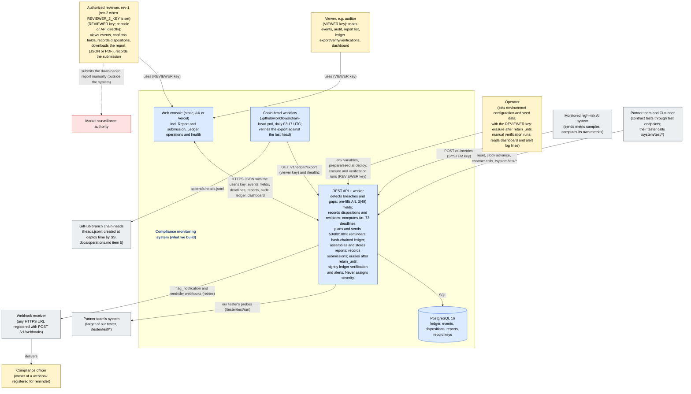
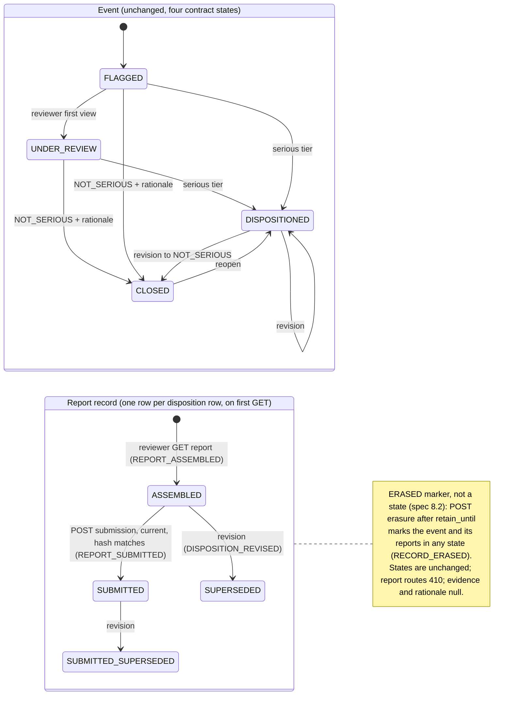
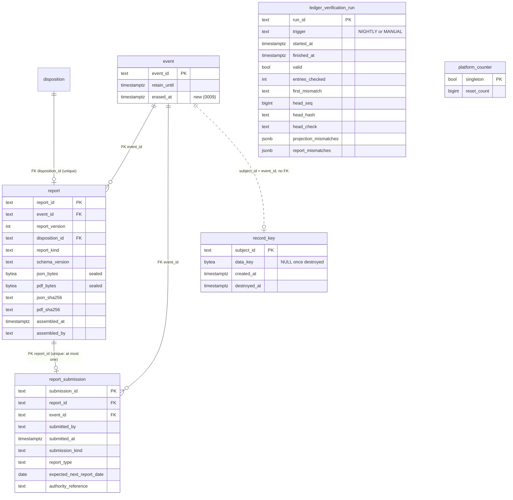

# Phase 5 models: what changed (spec section 8)

Written at integration from the merged code and tests (`phase5-integration`, Parts 1 to 3
merged; Phase 5 spec 8). It replaces nothing in [`phase4_models.md`](phase4_models.md): it
adds the Phase 5 rows and diagrams. Every diagram below is drawn from the code (the routes,
migrations 0008 to 0010 and `app/reports.py`), and every test named here exists on this branch.
The design-requirement mapping used for the tester's `coverage.model` is
[`phase5_design_requirements.md`](phase5_design_requirements.md).

## 8.1 Context diagram

Source and images: [`context-diagram-phase5.mmd`](context-diagram-phase5.mmd) (`.png`, `.svg`),
in the notation of the Phase 4 context diagram. The block below is the same diagram without its
title. Docs round (decision 343): PostgreSQL is drawn as its own store, not inside the Fly app
(it is a separate Fly Postgres app); the web console, the partner team and the test endpoints
are back; the operator acts with the reviewer key; the chain-head workflow pulls the export
itself, and its `chain-heads` branch is created at deploy time.

Unchanged from Phase 4: no identity provider, webhooks only, no Evidently. The Phase 4
"report submission not built yet" marking is gone: the reviewer downloads the report and
records the manual submission in the system (Part 1, spec 3.7).

## 8.2 Model 1 (state machine)

The event states are still the four contract states (D1). Report records have their own
statuses, as `GET /v1/events/{id}/reports` lists them (`app/reports.py`, `listing`).
Source and images: [`model1-state-machine-phase5.mmd`](model1-state-machine-phase5.mmd)
(`.png`, `.svg`); the gap, escalation and delivery sub-machines are unchanged in
[`model1-state-machine-phase4.mmd`](model1-state-machine-phase4.mmd).

| From | Trigger and guard | To | Ledger | Test |
| --- | --- | --- | --- | --- |
| DISPOSITIONED (serious tier) | Reviewer GET report, no report for the latest disposition row | report ASSEMBLED | REPORT_ASSEMBLED | `test_report_after_a_disposition_is_200_not_501` |
| CLOSED (NOT_SERIOUS) | Reviewer GET report | closure report ASSEMBLED, marked NOT FOR SUBMISSION (D2) | REPORT_ASSEMBLED | `test_closure_report_for_not_serious_has_no_deadline` |
| ASSEMBLED | POST submission, current report, matching hash | SUBMITTED | REPORT_SUBMITTED | `test_submission_records_reviewer_time_and_hash` |
| ASSEMBLED or SUBMITTED | Disposition revision | SUPERSEDED or SUBMITTED_SUPERSEDED (derived); next GET assembles version n+1 | DISPOSITION_REVISED | `test_a_revision_creates_a_new_report_version`, `test_report_status_is_ready_then_submitted` |
| any, after `retain_until` | POST erasure | ERASED marker (not a state): report routes 410 | RECORD_ERASED | `test_ac18_personal_data_is_unreadable_after_erasure` |
| FLAGGED or UNDER_REVIEW | GET report | unchanged (409 NO_DISPOSITION) | none | `test_ac08_a_report_without_a_disposition_is_409_and_changes_nothing` |

REJECTED (a response, not a state) gains: submission of a non-current report (409
`REPORT_NOT_CURRENT`), of an already-submitted one (409 `REPORT_ALREADY_SUBMITTED`), of a
closure report (409 `NOT_SUBMITTABLE`) or with a wrong hash (409 `REPORT_HASH_MISMATCH`).
Model 1's Phase 2 names map as before: REPORT_READY = ASSEMBLED.

## 8.3 Model 2 (data schema)

Source and images: [`model2-data-schema-phase5.mmd`](model2-data-schema-phase5.mmd) (`.png`,
`.svg`); the tables of migrations 0001 to 0007 are in
[`model2-data-schema-phase4.mmd`](model2-data-schema-phase4.mmd). Docs round (decision 343):
`report_submission.event_id` is drawn as the foreign key it is (`fk_report_submission_event`),
`record_key` is linked dashed because `subject_id` has no foreign key (the Phase 4 convention),
and a disposition has at most one report (`uq_report_disposition`).

- `report`, `report_submission` and `ledger_verification_run` are insert-only (grants INSERT
  and SELECT, plus a trigger rejecting UPDATE and DELETE); `record_key` is never deleted;
  `platform_counter` is written only by reset (`test_phase5_tables_and_grants`,
  `test_report_tables_are_insert_only`).
- The three report timestamps live inside the stored JSON; only `assembled_at` is a column.
- `ledger_entry.payload`: "jsonb; personal values sealed per record key from 0009 (P2); webhook
  URL as url_sha256 (D16)" (`test_webhook_registered_carries_url_sha256_not_url`).

## 8.4 Model 4 (invariants)

| INV | Phase 4 | Phase 5 (as merged) | Tests |
| --- | --- | --- | --- |
| INV-1 | Partly | **Holds:** a report exists only for an event with a disposition row, and every disposition row has four decided fields | `test_report_after_a_disposition_is_200_not_501`, `test_ac08_a_report_without_a_disposition_is_409_and_changes_nothing`, `test_ac13_report_matches_the_schema` |
| INV-4 | Holds | Still holds; `report`, `report_submission`, `ledger_verification_run` join the insert-only tables | `test_report_tables_are_insert_only` |
| INV-7 | Partly | **Holds:** chain links, plus the nightly run passes | `test_nightly_verify_records_a_valid_run`, `test_model5_ex5_nightly_verify_finds_a_payload_edit` |
| INV-8 | Differs | Still Differs: reading a stored report appends nothing; assembly and submission append (D19) | `test_reading_a_stored_report_appends_nothing` |
| INV-9 | Partly | **Holds:** report generation and submission are REVIEWER-only | `test_ac14_the_reviewer_gets_the_report_and_others_are_denied`, `test_submission_roles` |
| INV-10 | Partly | **Holds** in Phase 5's meaning: nothing is removed (no purge, D9) and erasure is refused before `retain_until` | `test_nothing_is_erased_before_retain_until`, `test_erasure_before_retain_until_is_409_and_changes_nothing` |
| INV-11 | Partly | **Holds:** destroying a record key changes no ledger hash, and verify passes | `test_ac18_chain_positions_and_hashes_are_unchanged_and_verify` |
| INV-14 (new) | — | Stored report bytes never change: SHA-256 of the opened bytes = the `report` hashes = the `REPORT_ASSEMBLED` payload | `test_report_bytes_are_served_exactly_as_stored`, `test_tampered_report_bytes_are_found_by_the_nightly_check` |
| INV-15 (new) | — | At most one submission per report; only the current serious report is submittable | `test_a_report_is_submitted_at_most_once`, `test_only_the_current_report_can_be_submitted` |

INV-2, 3, 5, 6, 12 and 13 are unchanged, and their Phase 4 tests carry over.

## 8.5 Model 3 (timeline)

Unchanged. Its note, [`model3-timeline-phase4.md`](model3-timeline-phase4.md), now says that a
submitted current report clears alerts A6 and A7 and does not stop reminders (Model 5 Ex-1 shows
the reminders continuing after the submission).

## 8.6 Model 5 (worked examples)

[`tests/fixtures/phase5/model5_examples.json`](../../tests/fixtures/phase5/model5_examples.json)
(its README gives the source of every value) is the Phase 4 file with:

- **Ex-1:** at d3 +1 h, the report (200; detected d0, determined d0 + 4 h, last revised d3,
  assembled at the request; 10-day window; `REPORT_ASSEMBLED` carries the served hash), then a
  submission (201 `INITIAL`). The reminders that follow are unchanged.
- **Ex-2:** the report is 200 `NOT_SERIOUS_CLOSURE` (no deadline, the rationale, NOT FOR
  SUBMISSION) instead of 501; its submission is 409 `NOT_SUBMITTABLE`.
- **Ex-4:** unchanged.
- **Ex-5:** in-process only, `test_model5_ex5_nightly_verify_finds_a_payload_edit` (the
  runner lists and skips it).
- **Ex-3:** still covered by the AC-02 tests.

`tools/run_model5.py` runs Ex-1, Ex-2 and Ex-4 over HTTP in the CI image job.

## 8.7 Deployment view

[`deployment-phase5.mmd`](deployment-phase5.mmd) (`.png`, `.svg`), in the notation of
[`deployment-phase4.mmd`](deployment-phase4.mmd): the Fly app (processes `api` and `worker`, the
worker adding the nightly verification and the alert step; `prepare` as the release command), the
separate Fly Postgres app, the console on Vercel, the Docker Compose stack started by the CI
`image` job, and the chain-head workflow with its `chain-heads` branch. The workflow runs on main
on its schedule once merged, and the `chain-heads` branch is created at deploy time by SS
(`docs/operations.md` item 5; decisions 311 and 312).
